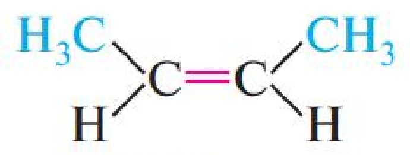

## Mavzu haqida

Ushbu bobda atom tuzilishi, molekulalar geometriyasi va kimyoviy bog'lanish turlari batafsil
bayon etiladi. Nazariy material har biri formula, sxema va mustaqil mashqlar bilan mustahkamlangan.

> [!NOTE]
> Har bir bob oxirida **yakuniy xulosalar**, **mustaqil mashqlar** va **test savollari**
> bo'limlari mavjud. Masalalar yechimlari kitob oxiridagi javoblar bo'limida berilgan.

## Asosiy tushunchalar

Atom va molekula o'zaro ta'sir natijasida **barqaror holat**ga o'tadi. Bu holat quyidagi
shartlar bilan belgilanadi:

- elektroneutralik;
- minimal potensial energiya;
- elektronlar joylashuvining maksimal simmetriyasi.

Elektron juftligi va kvant soni — molekulyar orbitallarni ifodalashning asosiy tili:

$$ \psi = \sum_i c_i \varphi_i $$

Energiya o'zgarishi quyidagi ko'rinishda yoziladi:

$$ \Delta E = E_{\text{reaktsiya}} - \sum E_{\text{reaktant}} $$

Bog'lanish energiyasi molekula massasiga bog'liq emas, faqat orbital kombinatsiyasiga bog'liq.

### Kovalent bog'lanish

Kovalent bog'lanish atomlar orasidagi elektronlar juftligi hosil qilish orqali vujud keladi.
Quyidagi jadval asosiy bog'lanish turlarini taqqoslaydi:

| Turi | Belgisi | Uzunligi, pm | Quvvati, kJ/mol | Namuna |
|---|---|---|---|---|
| Oqilona (bir) | – | 74 | 348 | H–H |
| Ikki | = | 67 | 614 | O=O |
| Uch | ≡ | 60 | 839 | N≡N |

### Molekulyar geometriya

VSEPR qoidasiga ko'ra elektron juftliklari bir-biridan qat'iy suriladi va molekula eng
kam qarama-qarshilik holatini egallaydi.

1. **Chiziqli** — 180°.
2. **Trigonal yassi** — 120°.
3. **Tetrahedral** — 109,5°.
4. **Osiy** — 120° va 90°.

> [!IMPORTANT]
> Geometriyani bashorat qilish uchun avval markaziy atomning elektron juftliklar sonini
> aniqlang: juftliklar soni = valentlik − bog'lanish soni.

## Rasmlar va sxemalar

Manzilarda kengaytirilgan tasvir quyidagicha bo'lishi mumkin:

## Mustaqil mashqlar

1. CH₄, NH₃, H₂O molekulalarining geometriyasini aniqlang.
2. Quyidagi juftlarda qaysi biri kuchliroq bog'langan: H–H yoki Cl–Cl? Izohlang.
3. VSEPR qoidasini asoslab, SO₂ molekulasining burchagini hisoblang.

- [ ] Rejalashtirish: 3-bob uchun eslatma yozish
- [x] 1-masala yechimini yozib chiqish

### Test savollari

1. Quyidagi molekulalardan eng uzun N–O bog'i qaysida?

A) NO₂
B) NO₃⁻
C) N₂O
D) HNO₃

2. Tetrahedral molekulada bog'lar orasidagi burchak:

A) 90°
B) 109,5°
C) 120°
D) 180°

## Yakuniy xulosalar

- Kovalent bog'lanish — elektron juftligi orqali vujud keladigan to'qnashuv.
- VSEPR qoidasi molekulyar geometriyaning asosini tashkil etadi.
- Nazariy bilimni mustahkamlash uchun har bir bobdagi mashqlarni bajarish shart.

## Adabiyotlar

- Atkins P. *Physical Chemistry*. — Oxford University Press.
- O'zbekiston Respublikasi Oliy ta'lim vazirligi, *Kimyo fani dasturlari*.
